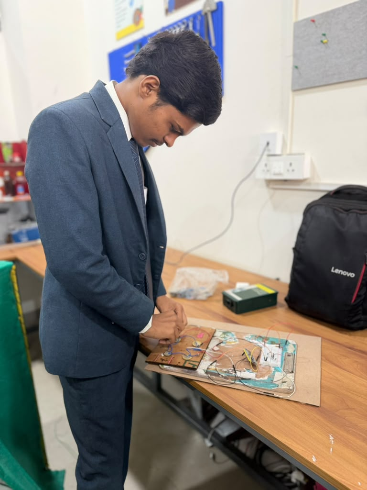
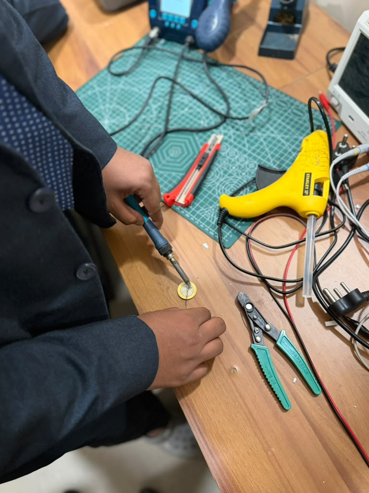
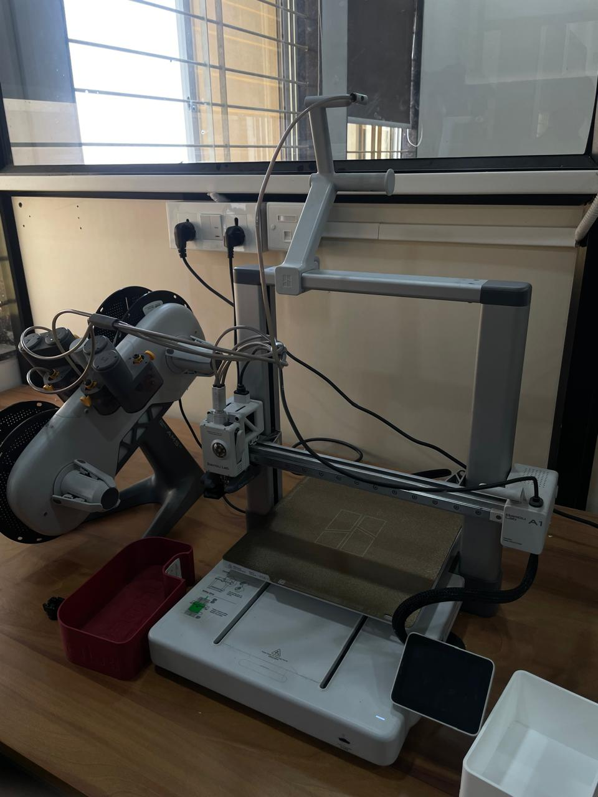
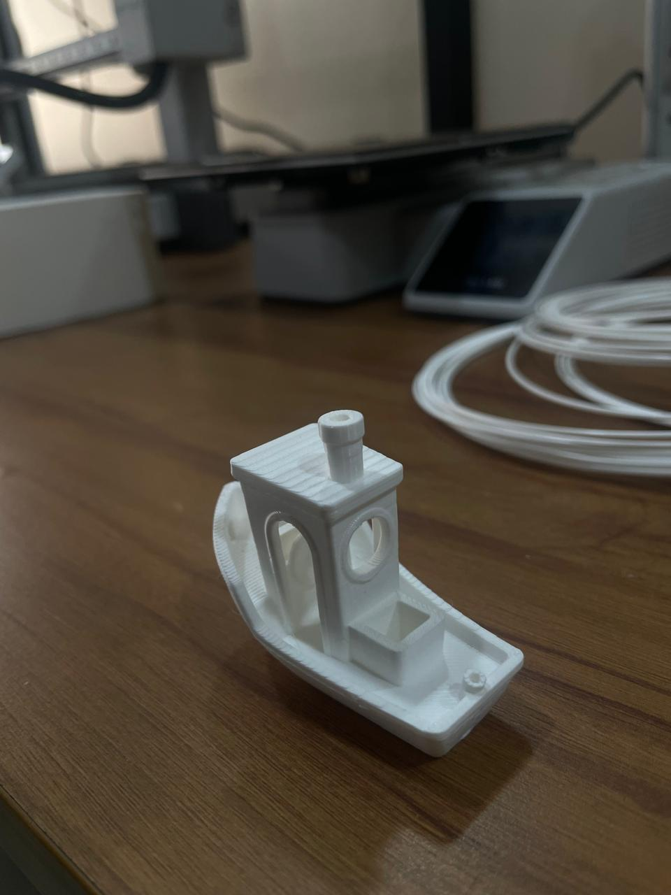
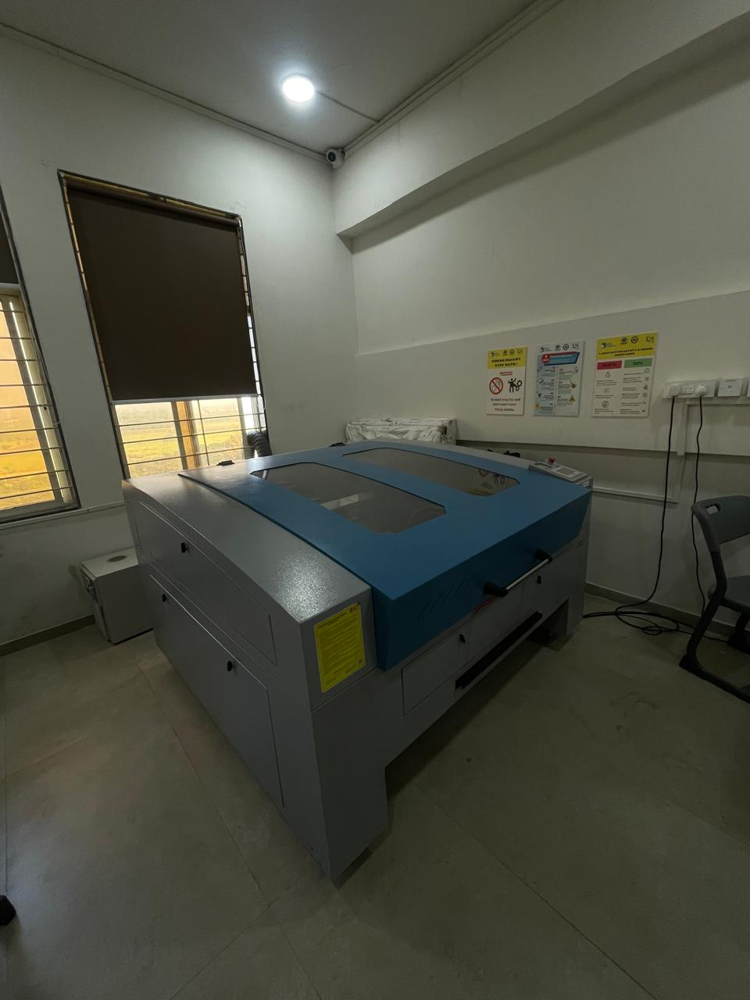
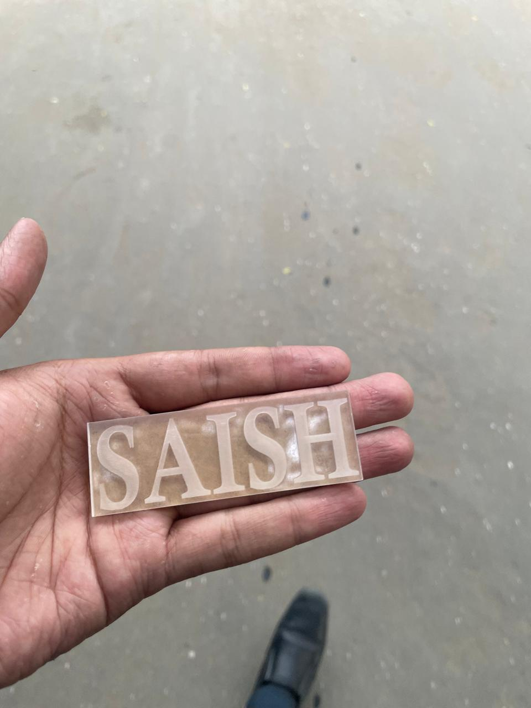

# MAGIC STEP — Footstep Power Generation System

**Group 16 · Department of Mechanical Engineering · Sanjivani University, Kopargaon**

Magic Step is an engineering project exploring how piezoelectric sensors can convert footstep pressure into electrical energy. The project records a six-disc wooden sensor platform, a separate breadboard-based electronics assembly, SolidWorks component modelling, prototype integration, and supervised manufacturing learning at Tinkerers Lab.

**Project status:** Prototype and design records are documented. Electrical output, charging behavior, and battery performance have not been independently validated; no measured performance is claimed.

[Open the published website](https://saishgodage45-jpg.github.io/magic-step-website/)

## Project overview

The project investigates a possible energy-conversion path from footstep pressure through piezoelectric generation, bridge rectification and energy conditioning toward battery storage. An ESP32 development board is listed separately for monitoring and control where implemented. The functional diagram is an architecture concept, not a wire-level circuit; it does not establish component compatibility or safe battery charging.

### Objectives

- Explore piezoelectric energy conversion under footstep pressure.
- Develop and document the mechanical sensor platform and component models.
- Record the intended electronics sequence without inventing unverified connections.
- Demonstrate the design-to-product workflow and document manufacturing learning.
- Identify the testing and safety reviews needed before reporting results.

### Hardware inventory

| Component | Quantity | Purpose |
|---|---:|---|
| Piezoelectric discs | 6 | Convert applied mechanical strain into electrical output. |
| Wooden platform | 1 | Supports the six discs as a separate sensor platform. |
| Rectifier diodes | 4 | Form the bridge-rectification stage in the documented concept. |
| Capacitor, 50 µF | 1 | Included after rectification in the documented concept. |
| ESP32 development board | 1 | Monitoring and control where implemented; pin-level connections are not specified. |
| Boost converter | 1 | Listed voltage-conditioning stage; output compatibility is unverified. |
| TP4056 charging module | 1 | Listed charging module; cell compatibility and protection require review. |
| 3.7 V lithium-ion battery | 1 | Listed energy-storage component; confirm requirements before charging. |
| Battery holder | 1 | Holds the listed battery. |
| 400-point mini breadboard | 1 | Separate electronics prototyping base. |
| Jumper wires | As required | Interconnect stock; exact wiring is not documented. |

No purchase prices were provided. See the [Bill of Materials](docs/bill-of-materials.md) for the itemized list.

### Functional energy path

**Footstep pressure → Piezoelectric energy generation → Bridge rectification → Energy storage / conditioning → Charging module → Lithium-ion battery**

The listed capacitor and boost converter are shown in the detailed block diagram. The ESP32 is separate and is not represented as charging the battery. Exact wiring, charger input suitability, cell compatibility, and protection must be checked with the project supervisor before connecting or charging the battery.

## Design and manufacturing records

SolidWorks was used for 3D modelling, component design, and assembly development. The combined [3D CAD and SolidWorks gallery](https://saishgodage45-jpg.github.io/magic-step-website/#cad-design) includes individual component models, mechanical drawings, and project development photographs. A historical full-assembly screenshot is retained in the asset archive but not shown in the website gallery because its depicted configuration conflicts with the current component record.

The project fabrication record covers CAD work, preparation of the wooden sensor platform, piezoelectric sensor preparation, separate electronics assembly, and prototype integration. The following photographs document additional Tinkerers Lab learning activities; they are not claimed as Magic Step prototype components.

### Website features

- Responsive project portfolio with section navigation and print support.
- Combined CAD and SolidWorks gallery with click-to-expand image viewing.
- Interactive 3D concept explorer, functional system-architecture diagram, and searchable/filterable BOM.
- Technical documentation, prototype-development photos, and the Tinkerers Lab manufacturing gallery.

### Project development photographs



*Prototype integration work recorded during project development.*



*Piezoelectric sensor preparation documented at the workshop bench.*

### FDM 3D printing



*Bambu Lab A1 FDM 3D printer at Tinkerers Lab, Sanjivani University.*



*Benchy test model manufactured using FDM 3D printing.*

### Laser cutting and engraving



*Laser cutting machine at Tinkerers Lab, Sanjivani University.*



*Customized SAISH acrylic nameplate — laser-cutting and engraving output.*

## Project team and faculty guidance

**Student project members — Group 16**

- Saish Godage
- Ayush Jadhav

**Faculty guidance**

- Dr. K. C. Bhosale — HOD, Department of Mechanical Engineering
- Dr. Kiran Wakchaure — Project Guide
- Dr. Vasudeo Singh Singer — Project Guide

## Technical documentation

| Document | Coverage |
|---|---|
| [Project overview](docs/project-overview.md) | Project summary, team, and scope |
| [Objectives, scope, and limitations](docs/objectives-and-scope.md) | Goals, boundaries, and future work |
| [Working principle](docs/working-principle.md) | Piezoelectric principle and conceptual energy flow |
| [System architecture](docs/system-architecture.md) | Functional blocks and diagram limits |
| [Mechanical design and CAD](docs/mechanical-design.md) | Project-record dimensions, SolidWorks, and verification notes |
| [Electronics and circuit documentation](docs/electronics-and-firmware.md) | Component roles, functional flow, and unknown connections |
| [Bill of Materials](docs/bill-of-materials.md) | Quantities, purposes, and unreported prices |
| [Manufacturing and fabrication](docs/manufacturing-and-fabrication.md) | Project build record versus Tinkerers Lab activities |
| [Hardware and software](docs/hardware-and-software.md) | Project hardware and website/tool requirements |
| [Team and acknowledgements](docs/team-and-acknowledgements.md) | Student members, faculty, and acknowledgements |
| [Testing and results](docs/testing-and-results.md) | Test-record template; no measured results claimed |
| [Safety and maintenance](docs/safety-and-maintenance.md) | Electrical, battery, and mechanical precautions |
| [Website setup and deployment](docs/software-and-deployment.md) | Local preview and existing GitHub Pages configuration |

## Website setup

The website is a static HTML, CSS, and JavaScript project with no package installation or build step. From the repository root, start a local server:

```powershell
python -m http.server 8000
```

Open <http://localhost:8000/>. A modern browser and an internet connection are needed for the hosted Three.js scripts and Google Fonts. The local website itself does not require credentials or a backend service.

## Repository structure

```text
.
├── index.html
├── assets/
│   ├── css/                    # Responsive website styles
│   ├── images/
│   │   ├── cad/                # Retained original CAD development record
│   │   ├── engineering-journey/
│   │   └── manufacturing/      # Tinkerers Lab photographs and outputs
│   ├── js/                     # Project data, site UI, gallery, 3D explorer
│   ├── media/                  # Functional diagrams and design illustrations
│   ├── models/                 # Retained 3D model assets
│   └── solidworks/             # Component modelling screenshots
├── docs/                       # Technical project documentation
└── magic_step_website/         # Retained legacy mirror, not the Pages source
```

## GitHub Pages

GitHub Pages is already configured to publish the repository root (`/`) from the `main` branch. The current deployment mode is the existing branch-based configuration; no parallel Actions workflow was added. Changes on another branch do not appear on the public site until they are merged into the configured source branch and Pages completes a build. See [website setup and deployment](docs/software-and-deployment.md).

## References and acknowledgements

The site includes references on piezoelectric energy harvesting and acknowledges the Department of Mechanical Engineering and Tinkerers Lab at Sanjivani University for facilities and guidance. See the [website references section](https://saishgodage45-jpg.github.io/magic-step-website/#references).
