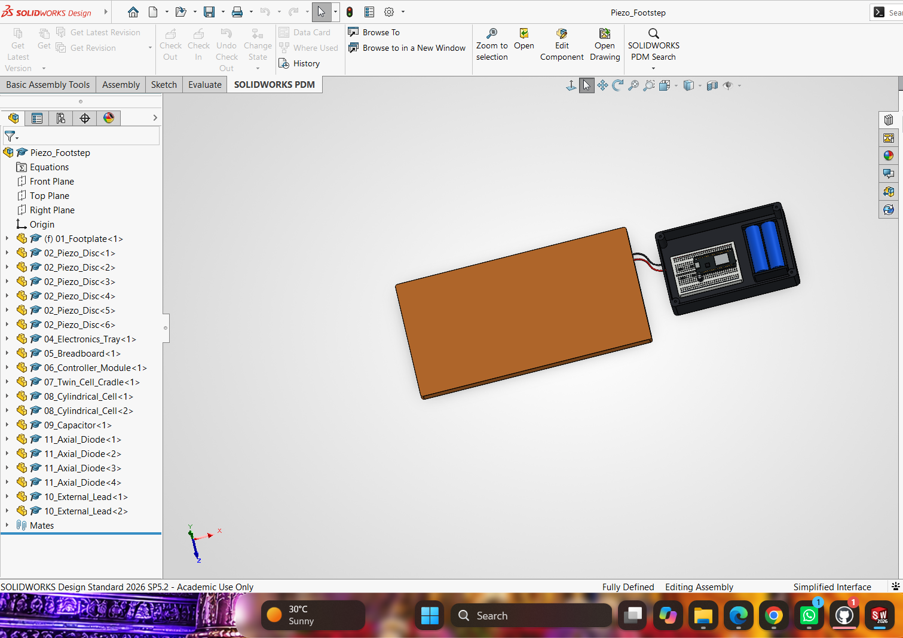

# Magic Step — Footstep Power Generation System

**Engineering project documentation website** · Sanjivani University, Kopargaon · Department of Mechanical Engineering

[Open the live website](https://saishgodage45-jpg.github.io/magic-step-website/)



*SolidWorks assembly showing the wooden footplate and separate electronics tray.*

## Project overview

Magic Step is a student engineering project exploring how mechanical energy from human footsteps can be converted into electrical energy. Six piezoelectric discs mounted beneath a wooden platform produce electrical pulses when mechanically strained. The proposed electronics rectify and condition those pulses, then route energy toward rechargeable battery storage. An ESP32 development board is included in the documented electronics system.

The website is a static project journal and technical reference. It contains project descriptions, design documentation, SolidWorks screenshots, prototype-development photos, and an interactive Three.js representation of the assembly. It does not report fabricated experimental results; measurements in the testing documentation remain clearly identified as pending or requiring confirmation.

## Problem statement

Footsteps transfer mechanical energy into walking surfaces. This project investigates whether a small part of that otherwise dissipated mechanical energy can be captured with piezoelectric sensors and made available to an electrical storage system. It also documents the mechanical, electrical, embedded-software, and fabrication considerations involved in exploring that approach.

## Proposed solution

The documented system uses a 300 × 160 × 10 mm wooden platform with six 27 mm piezoelectric discs arranged in a 2 × 3 array underneath. A four-diode bridge rectifier converts the sensor output to unidirectional pulses; a capacitor buffers the output, and a boost-converter/TP4056 charging path is included in the proposed energy-management arrangement for lithium-ion storage. The ESP32 development board supports the project's embedded monitoring and control work.

**Capacitor value needs reconciliation:** the hardware list supplied for this README specifies **50 µF**, while the existing website and detailed circuit documents specify **10 µF**. Confirm the value against the assembled hardware and update the circuit, BOM, CAD caption, and documentation together before treating either value as final.

## Hardware components

| Component | Documented role |
|---|---|
| Six 27 mm piezoelectric discs | Convert mechanical strain into electrical pulses |
| Wooden footstep platform | Applies footstep force to the sensor array |
| Four diodes / bridge rectifier | Rectify the piezoelectric output |
| Capacitor | Buffer and smooth rectified output; value requires reconciliation (see above) |
| Boost converter | DC–DC conditioning stage |
| TP4056 charging module | Lithium-ion charging stage |
| Lithium-ion cells and battery holder | Rechargeable energy storage |
| ESP32 development board | Embedded monitoring and control |
| 400-point mini breadboard | Circuit prototyping and interconnection |
| Jumper wires | Electrical connections between modules |

The model viewer depicts the tray, breadboard, controller, rectifier diodes, capacitor, converter, charging module, battery holder, two cells, and external leads as separate components. It intentionally does not include an LCD or springs.

## Project team and faculty guidance

**Project team**

- Saish Godage
- Ayush Jadhav

The website also lists student contributors Gaurav Wavdhane and Sai Gholap.

**Faculty guidance**

- Dr. K. C. Bhosale — Head of Department (HOD), Department of Mechanical Engineering, Sanjivani University, Kopargaon
- Dr. Kiran Wakchaure — Director – Projects, Sanjivani University, Kopargaon

## Software, design tools, and practical skills

**Tools and technologies:** SolidWorks, Visual Studio Code, GitHub, GitHub Copilot, HTML, CSS, JavaScript, and Three.js.

**Manufacturing and hands-on learning topics:** laser cutting, 3D printing, CAD modelling, prototype assembly, and basic electronics integration.

The repository currently contains no actual laser-cutting or 3D-printing photographs; the corresponding website cards use explicitly labelled placeholders. No photos have been fabricated. Add project photographs under `assets/images/` when they are available.

## Website features

- Interactive Three.js prototype viewer with assembled/exploded views, part inspection, layer visibility, dimensions, orbit, pan, zoom, and reset controls.
- Responsive SolidWorks gallery with 11 actual assembly/component screenshots and click-to-enlarge viewing.
- Engineering development timeline with prototype and electronics photographs.
- Project overview, working-principle diagrams, electronics documentation, testing matrix, BOM, and academic references.
- Hands-on learning section for laser cutting and 3D printing.
- Faculty and student information, print support, and dark/light themes.

The interactive viewer builds its geometry directly in JavaScript and does not fetch the retained `assets/models/piezo_footstep.glb` file. Three.js r128 and its matching OrbitControls script are loaded from CDNs by `index.html`; a network connection is required for those scripts and the hosted web fonts.

## Project photographs and design gallery

The following are real project assets stored in the repository:


*Prototype integration during project development.*


*Piezoelectric sensor preparation.*

All 11 SolidWorks screenshots are in [`assets/solidworks/`](assets/solidworks/):

`complete-assembly.png` · `wooden-footplate.png` · `mini-breadboard.png` · `electronics-tray.png` · `piezoelectric-disc.png` · `axial-diode.png` · `18650-cell.png` · `twin-cell-cradle.png` · `external-lead.png` · `capacitor.png` · `esp32-controller.png`

Other real development photographs are in [`assets/images/engineering-journey/`](assets/images/engineering-journey/). The schematic, CAD-style diagrams, and illustrative media are organized under `assets/media/`.

No demonstration video files are currently included in the repository. Add a video only when a suitable project recording is available; large media can be linked from an appropriate hosting service instead of committed as a repository asset.

## Documentation

| Document | Contents |
|---|---|
| [Project overview](docs/project-overview.md) | Abstract, problem statement, objectives, team, and supervision |
| [Working principle](docs/working-principle.md) | Piezoelectric operation and energy-flow description |
| [Mechanical design](docs/mechanical-design.md) | Platform and mechanical design notes |
| [Electronics and firmware](docs/electronics-and-firmware.md) | Circuit, ESP32 connections, and firmware notes |
| [Testing and results](docs/testing-and-results.md) | Test matrix and result-recording guidance |
| [Safety and maintenance](docs/safety-and-maintenance.md) | Electrical and battery safety notes |

The root `index.html` and `assets/` tree are the canonical GitHub Pages site. `magic_step_website/` is a retained legacy copy and is not the Pages deployment source.

## Run locally

This is a static site: it has no build step, package manager, or local runtime dependency to install. From the repository root, start a local HTTP server:

```powershell
python -m http.server 8000
```

Then open <http://localhost:8000/>. Alternatively, use the Visual Studio Code Live Server extension. Serving the files over HTTP is recommended for consistent browser behaviour; the Three.js and OrbitControls CDN scripts require internet access.

## Repository layout

```text
.
├── index.html
├── README.md
├── .gitignore
├── assets/
│   ├── css/site.css
│   ├── images/engineering-journey/   # Prototype and development photographs
│   ├── js/                            # Project data, site UI, gallery, 3D viewer
│   ├── media/
│   │   ├── cad/
│   │   ├── diagrams/
│   │   └── photos/                    # SVG illustrative media
│   ├── models/piezo_footstep.glb      # Retained model asset; not fetched by viewer
│   └── solidworks/                    # 11 SolidWorks screenshots
├── docs/                              # Technical project documentation
└── magic_step_website/                # Retained legacy site copy
```

The folder names used by the running site are kept as-is so its relative asset paths continue to work. No `assets/videos/` folder is present because no video files are currently available.

## GitHub Pages

The repository's Pages configuration deploys the **root (`/`) of the `main` branch**. The live site is [saishgodage45-jpg.github.io/magic-step-website](https://saishgodage45-jpg.github.io/magic-step-website/).

## Future scope

Possible future work includes characterizing energy-conversion performance with documented test conditions, improving power-conditioning and storage integration, adding battery monitoring and sensor integration, collecting and presenting measured system data, and evaluating the design at larger scales. These are future possibilities, not claims of completed work or measured performance.

## Credits and licensing

Project credits are listed above and on the website. No `LICENSE` file has been added because no project license was specified. The site uses Three.js r128 and Google Fonts through their published CDN endpoints.
